

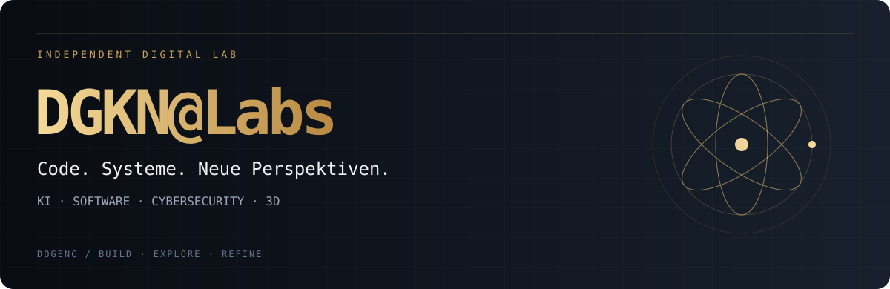

 

**KI & Automatisierung · Software & Systeme · Cybersecurity · Interaktive 3D-Welten**

Ich entwickle unter **DGKN@Labs** eigene Werkzeuge, digitale Experimente und interaktive Lernwelten.  
Mich interessiert, wie Technik funktioniert — und was sich daraus bauen lässt.

[**Projekte**](#projekte) &nbsp; / &nbsp; [**Tech-Stack**](#tech-stack) &nbsp; / &nbsp; [**Instagram**](https://www.instagram.com/dgkn_labs/)

 

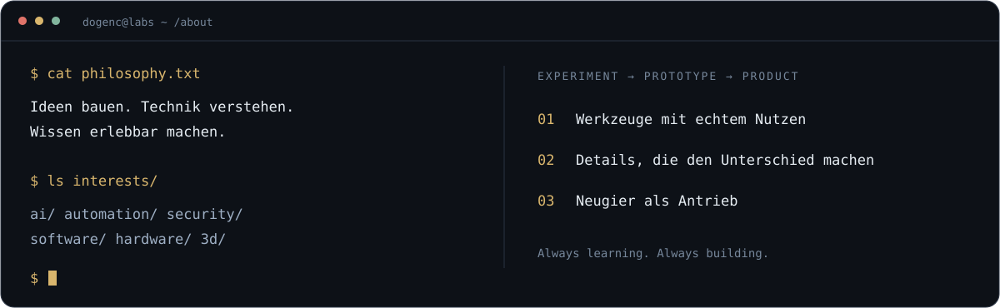

 

## Coding-Aktivität

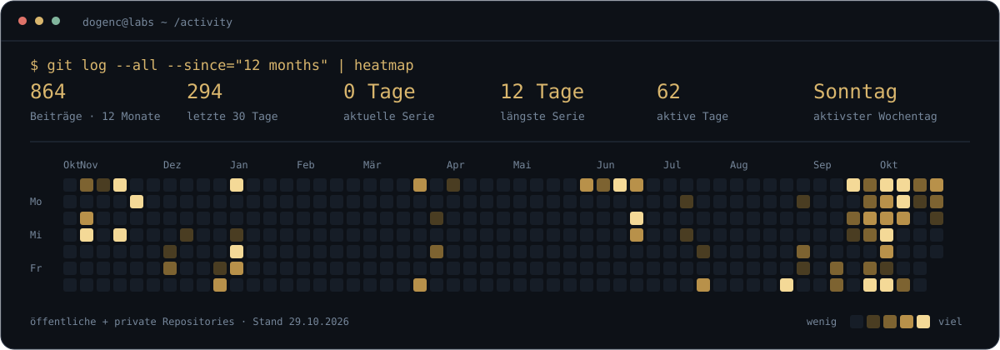

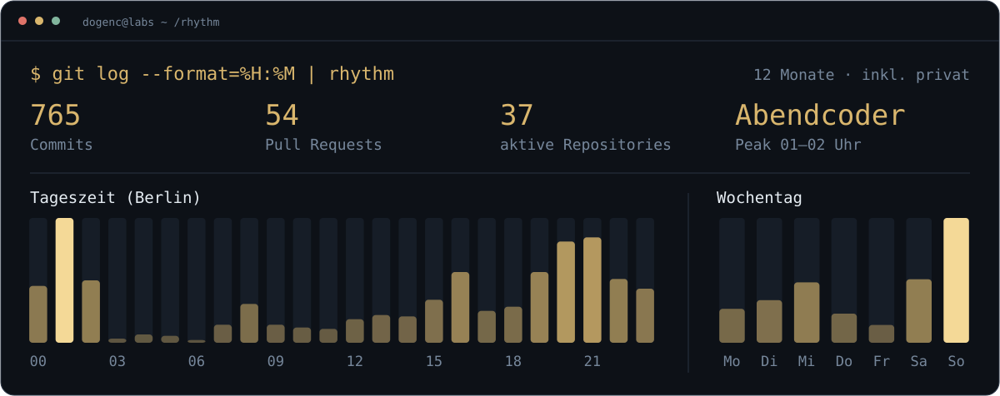

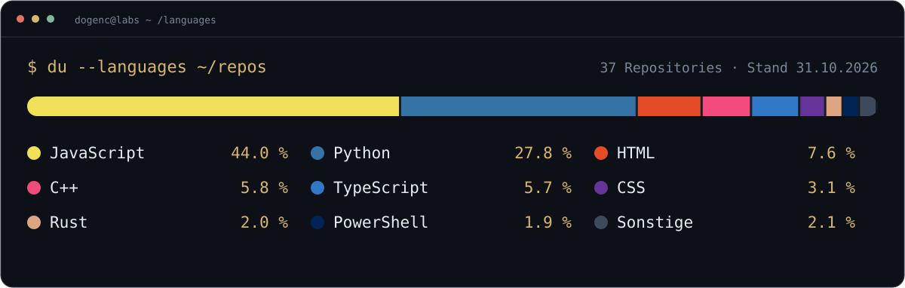

Automatisch alle 3 Stunden aktualisiert · zählt auch private Repositories (nur Summen, keine Namen oder Inhalte).

 

## Projekte

<table>
<tr>
<td colspan="2" valign="top">

<a href="https://github.com/dogenc/ASTRA"><b>ASTRA · Weltraum-Atlas</b></a> Das Universum interaktiv verstehen: 11 Himmelskörper in 3D, 5.080 Sterne, 88 Sternbilder und vier animierte Phänomene.

Atlas 05 · Deutsch · Browser, Windows &amp; macOS · Offline nutzbar · <a href="https://github.com/dogenc/ASTRA/releases/latest">Downloads</a> Planetentexturen: Solar System Scope · CC BY 4.0

</td>
</tr>
<tr>
<td width="50%" valign="top">
<a href="https://github.com/dogenc/SENTINEL-F">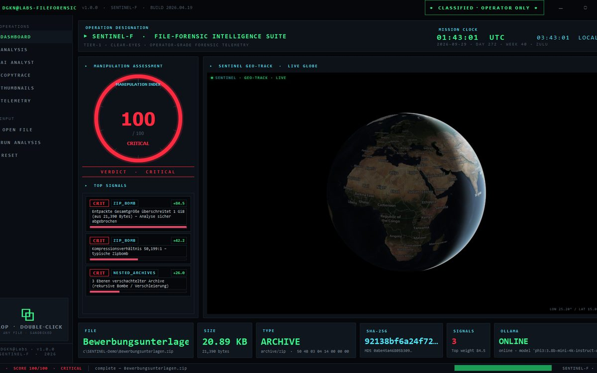</a>

<a href="https://github.com/dogenc/SENTINEL-F"><b>SENTINEL-F</b></a> Dateien forensisch prüfen und Berichte erstellen.

</td>
<td width="50%" valign="top">
<a href="https://github.com/dogenc/gguf-studio">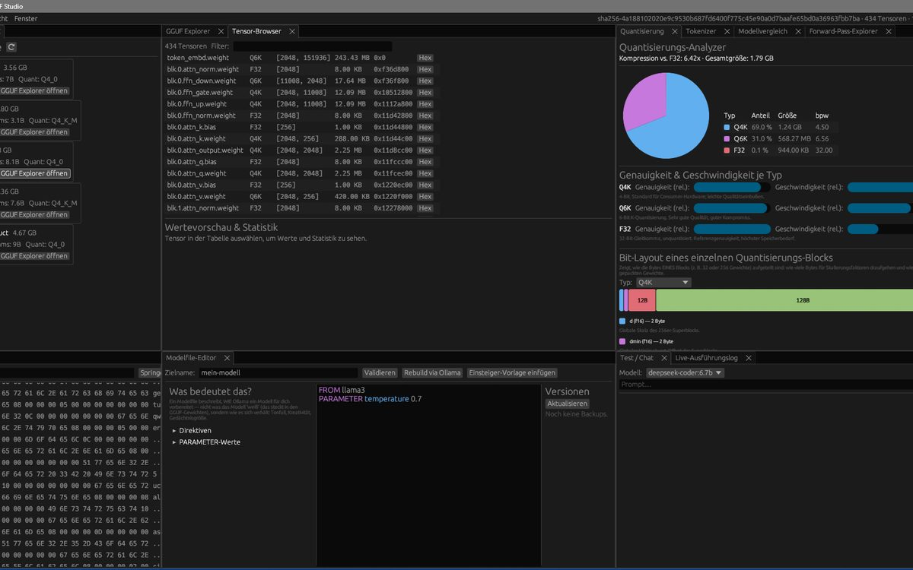</a>

<a href="https://github.com/dogenc/gguf-studio"><b>GGUF Studio</b></a> Lokale KI-Modelle, Tensoren und Quantisierung erkunden.

</td>
</tr>
<tr>
<td width="50%" valign="top">
<a href="https://github.com/dogenc/dgknCryptoSuite">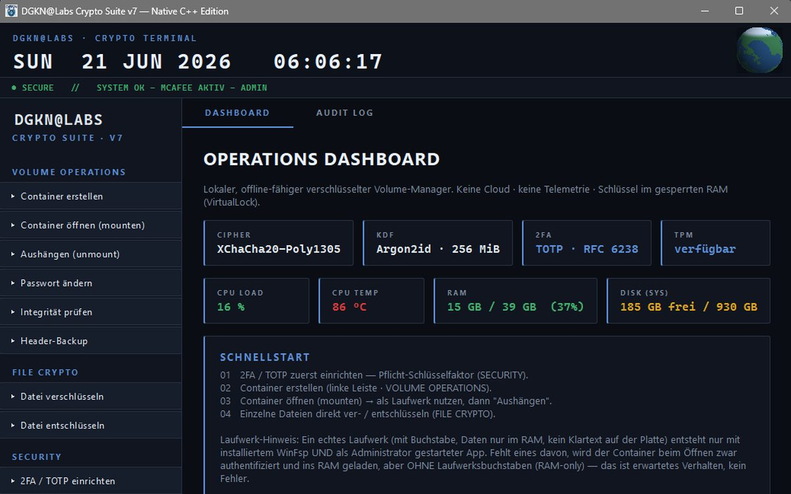</a>

<a href="https://github.com/dogenc/dgknCryptoSuite"><b>Crypto Suite</b></a> Verschlüsselte Container für Windows.

</td>
<td width="50%" valign="top">
<a href="https://github.com/dogenc/DGKN-Labs-Inspector">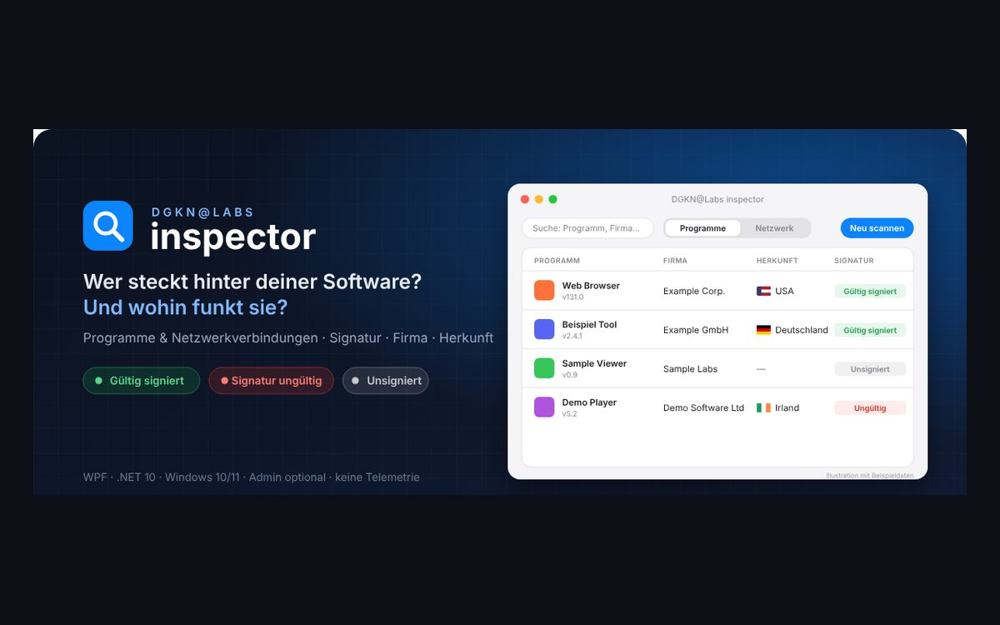</a>

<a href="https://github.com/dogenc/DGKN-Labs-Inspector"><b>Inspector</b></a> Wer hat ein Programm signiert – und wohin funkt es?

</td>
</tr>
<tr>
<td width="50%" valign="top">
<a href="https://github.com/dogenc/windows-system-utility">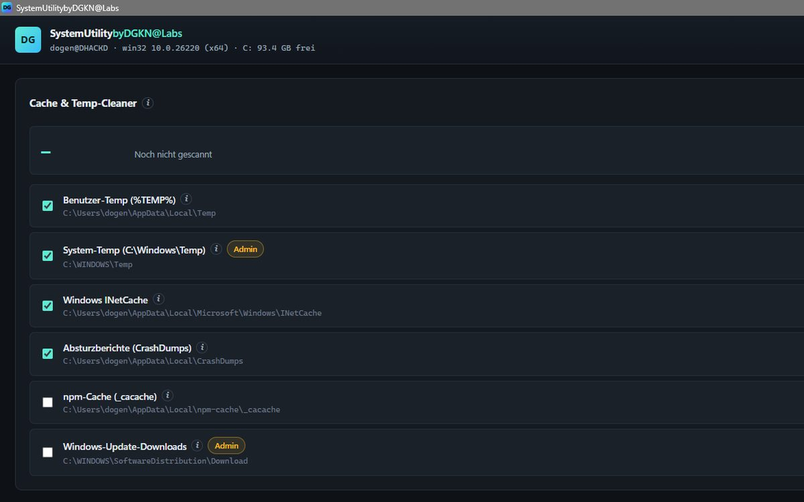</a>

<a href="https://github.com/dogenc/windows-system-utility"><b>System Utility</b></a> Windows aufräumen, Entwicklerpfade finden.

</td>
<td width="50%" valign="top">
<a href="https://github.com/dogenc/CORPUS-Anatomieatlas">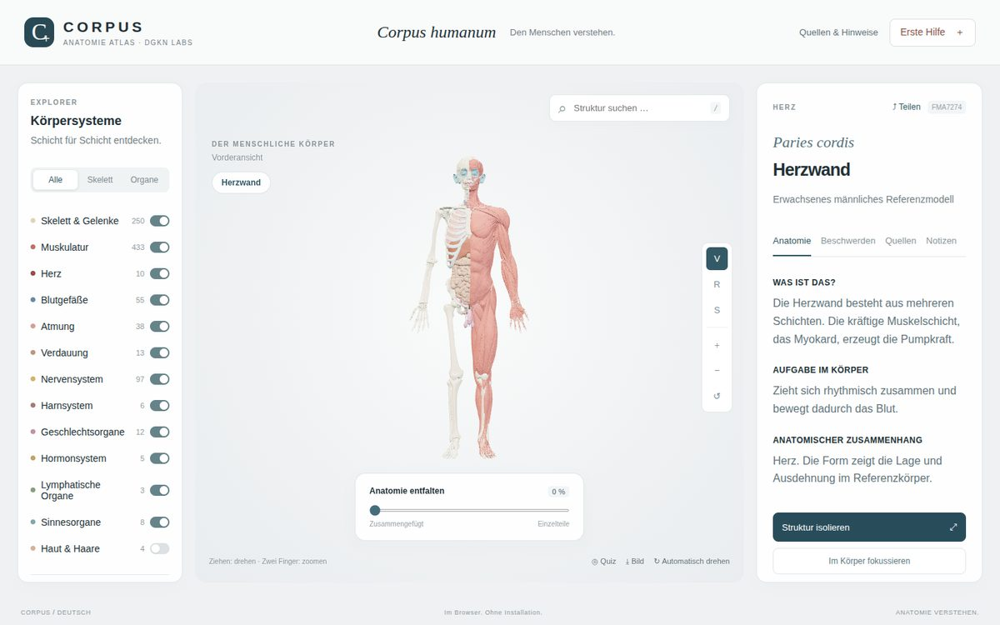</a>

<a href="https://github.com/dogenc/CORPUS-Anatomieatlas"><b>CORPUS</b></a> Der menschliche Körper in 3D.

</td>
</tr>
<tr>
<td width="50%" valign="top">
<a href="https://github.com/dogenc/CELLULA">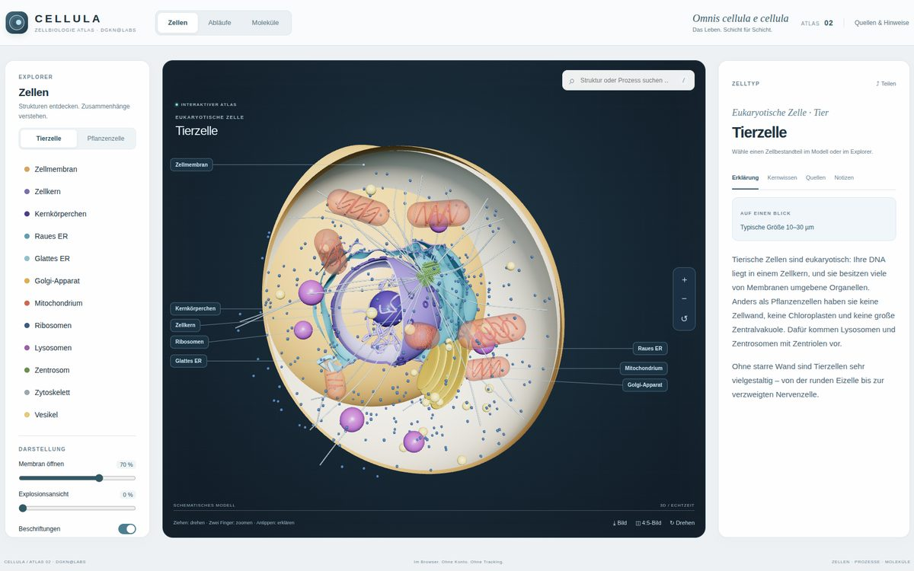</a>

<a href="https://github.com/dogenc/CELLULA"><b>CELLULA</b></a> Zellen und Moleküle interaktiv verstehen.

</td>
<td width="50%" valign="top">
<a href="https://github.com/dogenc/TERRA">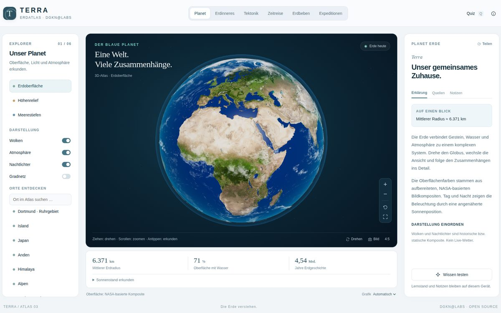</a>

<a href="https://github.com/dogenc/TERRA"><b>TERRA</b></a> Erdschichten und Plattentektonik in 3D.

</td>
</tr>
<tr>
<td width="50%" valign="top">
<a href="https://github.com/dogenc/ELEMENTA">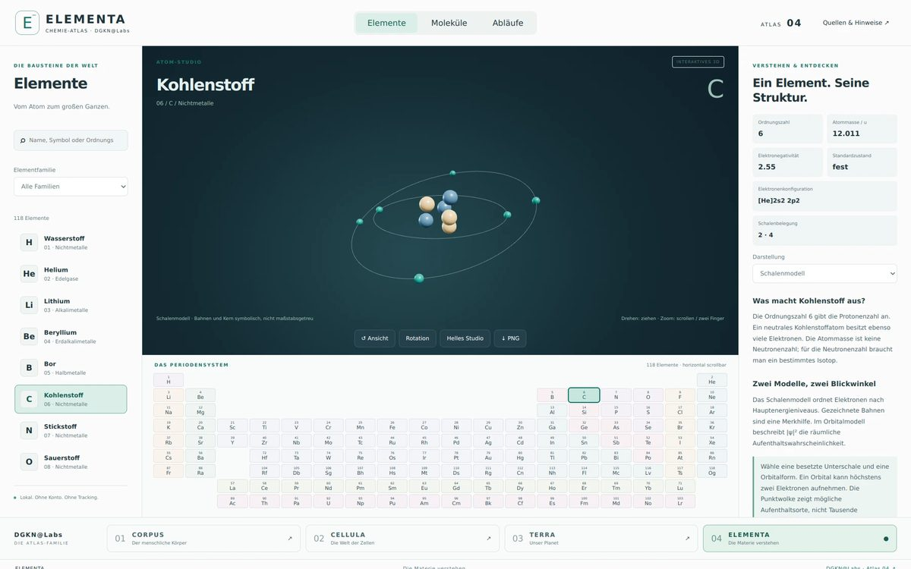</a>

<a href="https://github.com/dogenc/ELEMENTA"><b>ELEMENTA</b></a> Alle 118 Elemente, Orbitale und Moleküle in 3D.

</td>
<td width="50%" valign="top">
<a href="https://github.com/dogenc/3D-Globe-HTML---Test-01">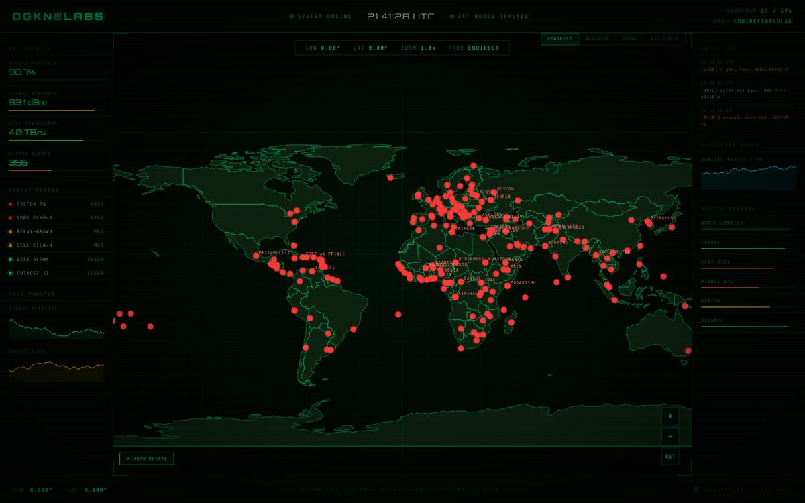</a>

<a href="https://github.com/dogenc/3D-Globe-HTML---Test-01"><b>3D Globe</b></a> Weltkarte im Intelligence-Terminal-Look.

</td>
</tr>
<tr>
<td width="50%" valign="top">
<a href="https://github.com/dogenc/bitcoin-toolbox">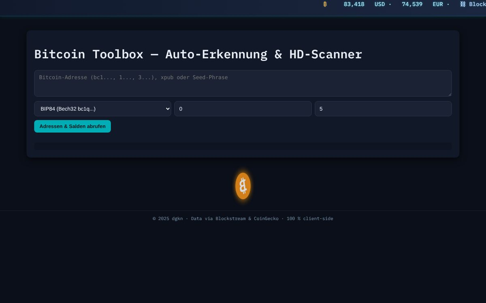</a>

<a href="https://github.com/dogenc/bitcoin-toolbox"><b>Bitcoin Toolbox</b></a> Adressen und HD-Wallets im Browser prüfen.

</td>
<td width="50%" valign="top">
<a href="https://github.com/dogenc/passwordgenerator">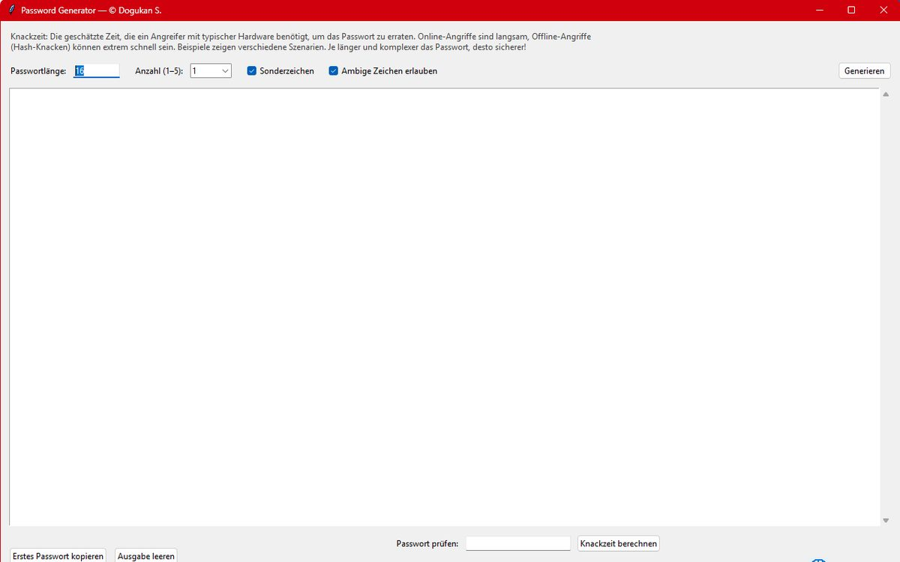</a>

<a href="https://github.com/dogenc/passwordgenerator"><b>Passwortgenerator</b></a> Sichere Passwörter samt Knackzeit.

</td>
</tr>
</table>

[**Alle Repositories auf GitHub →**](https://github.com/dogenc?tab=repositories)

## Tech-Stack

Technologien, mit denen ich arbeite, Projekte umsetze und experimentiere.

### Sprachen & Web

  
  
  
  
  
  
  
  
  

Java · HTML5 · CSS3 · C · C++ · Rust · Python · JavaScript · TypeScript

### Frameworks & Oberflächen

  
  
  
  

React · Three.js · Qt · Electron

### Systeme & Entwicklung

  
  
  
  
  

Linux · Docker · Cloudflare · Git · GitHub

Logos: <a href="https://github.com/tandpfun/skill-icons">Skill Icons</a>

## Direkt zum passenden Projekt

| Du möchtest … | Hier starten |
|---|---|
| eine Datei auf Auffälligkeiten untersuchen | [SENTINEL-F](https://github.com/dogenc/SENTINEL-F) |
| lokale KI-Modelle besser verstehen | [GGUF Studio](https://github.com/dogenc/gguf-studio) |
| verschlüsselte Container verwalten | [Crypto Suite](https://github.com/dogenc/dgknCryptoSuite) |
| Körper, Zellen, Erde, Chemie oder das All in 3D erkunden | [CORPUS](https://github.com/dogenc/CORPUS-Anatomieatlas) · [CELLULA](https://github.com/dogenc/CELLULA) · [TERRA](https://github.com/dogenc/TERRA) · [ELEMENTA](https://github.com/dogenc/ELEMENTA) · [ASTRA](https://github.com/dogenc/ASTRA) |
| Windows-Programme und Verbindungen prüfen | [Inspector](https://github.com/dogenc/DGKN-Labs-Inspector) |
| Windows aufräumen oder Entwicklerpfade finden | [System Utility](https://github.com/dogenc/windows-system-utility) |

## Woran ich gern arbeite

- **KI & Automatisierung:** Assistenten, lokale Modelle und praktische Workflows.
- **Software & Sicherheit:** nachvollziehbare Prozesse, Analysewerkzeuge und durchdachte Oberflächen.
- **Wissen & 3D:** komplexe Themen anschaulich und interaktiv vermitteln.
- **Hardware & Systeme:** Mikrocontroller, Linux und eigene Experimente.

---

 

[**Projekte**](https://github.com/dogenc?tab=repositories) &nbsp; · &nbsp; [**Instagram**](https://www.instagram.com/dgkn_labs/) &nbsp; · &nbsp; [**Zurück nach oben ↑**](#)

DGKN@Labs · Von der Idee zum eigenen System.

